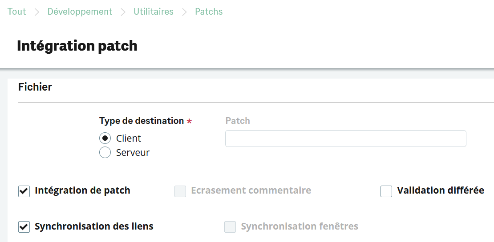
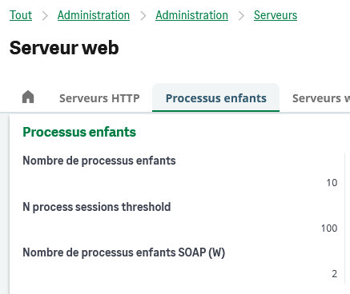
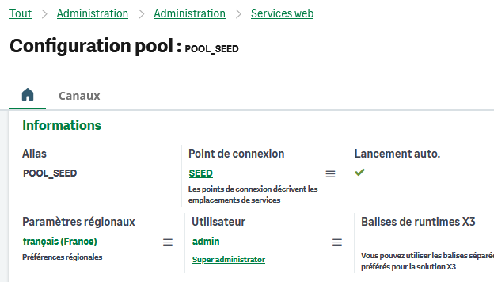
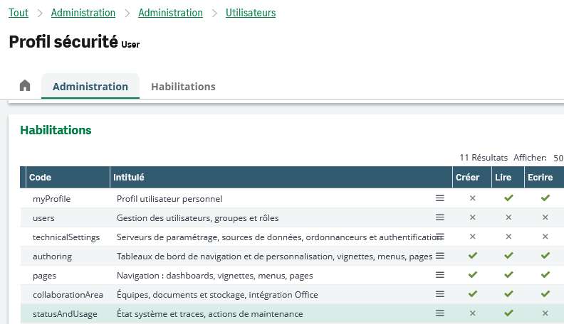
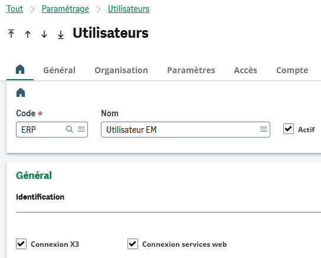
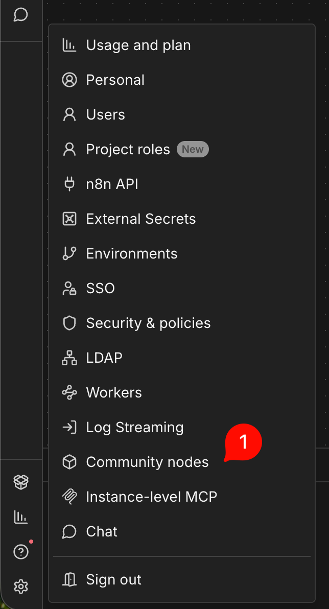
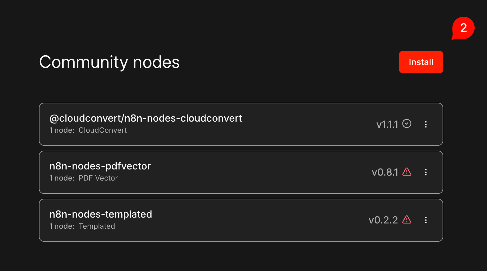
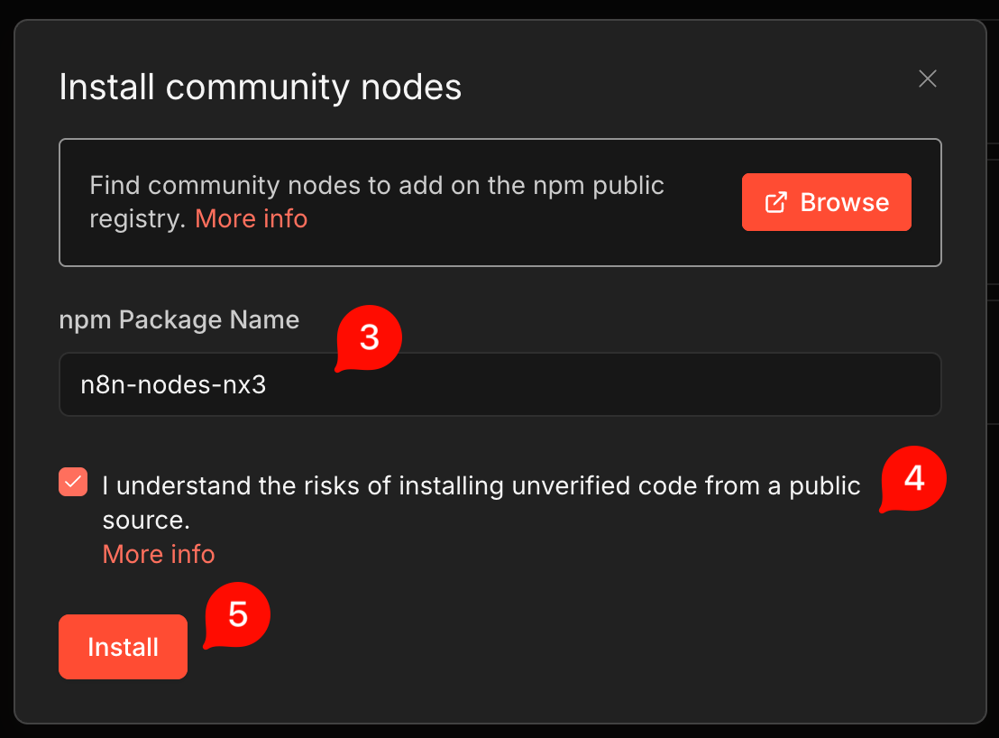
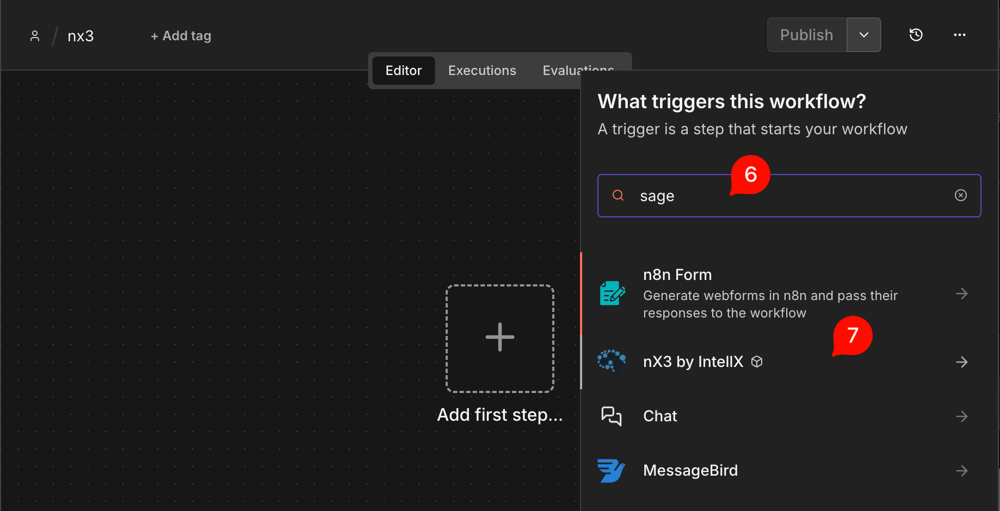
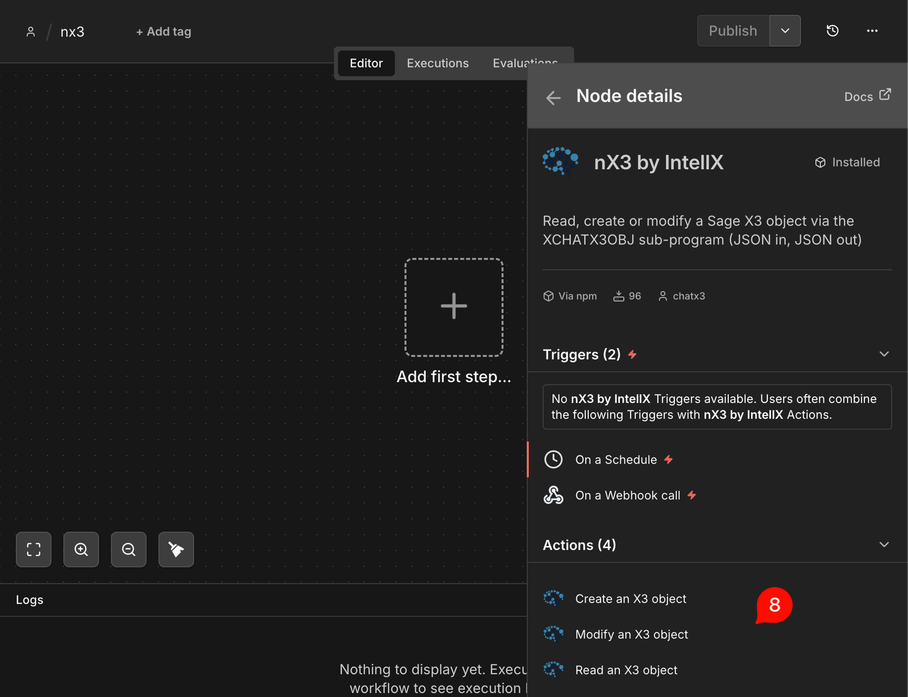

# n8n-nodes-nx3 — IntellX for Sage X3

[](https://www.npmjs.com/package/n8n-nodes-nx3)
[](https://www.npmjs.com/package/n8n-nodes-nx3)
[](https://docs.n8n.io/integrations/community-nodes/)

[🇬🇧 English](README.md) · **🇫🇷 Français**

Nœud communautaire [n8n](https://n8n.io/) pour lire, lister, créer, modifier
et décrire des objets **Sage X3**, et exécuter des requêtes SQL `SELECT` sur la
base X3 — depuis un workflow ou depuis un agent IA.

Le nœud s'appuie sur le web service SOAP `CAdxWebServiceXmlCC` de Sage X3 et
sur le sous-programme `XCHATX3OBJ` livré par le **patch ChatX3**. Vous ne
manipulez que du JSON : le nœud construit la requête SOAP, demande à X3 de
répondre en JSON natif et renvoie un objet propre, directement exploitable.
Aucun XML à écrire ni à parser.

## Sommaire

1. [Fonctionnement](#1-fonctionnement)
2. [Prérequis](#2-prérequis)
3. [Paramétrage côté Sage X3](#3-paramétrage-côté-sage-x3)
4. [Installation du nœud dans n8n](#4-installation-du-nœud-dans-n8n)
5. [Credential](#5-credential)
6. [Opérations](#6-opérations)
7. [Opérations sur les objets](#7-opérations-sur-les-objets)
8. [Opérations SQL](#8-opérations-sql)
9. [Sortie](#9-sortie)
10. [Options avancées](#10-options-avancées)
11. [Agent IA et MCP](#11-agent-ia-et-mcp)
12. [Exemples de workflows](#12-exemples-de-workflows)
13. [Dépannage](#13-dépannage)
14. [Compatibilité](#14-compatibilité)
15. [Support et ressources](#15-support-et-ressources)
16. [Historique des versions](#16-historique-des-versions)

---

## 1. Fonctionnement

| | |
|---|---|
| Package npm | `n8n-nodes-nx3` |
| Nœud n8n | **IntellX for Sage X3** (credential : *IntellX for Sage X3 API*) |
| Protocole | Web services SOAP Sage X3 (Syracuse), `CAdxWebServiceXmlCC` |
| Côté X3 | Sous-programme `XCHATX3OBJ`, installé par le patch ChatX3 |
| Périmètre | Objets et traitements standards, verticaux et spécifiques |
| Sécurité | Les droits fonctionnels de l'utilisateur Syracuse et du dossier s'appliquent à chaque appel |

Les échanges se font **directement entre votre instance n8n et votre serveur
Sage X3**. La passerelle ChatX3 n'intervient que pour le contrôle de licence
([§3.3](#33-url-de-licence)) : aucune donnée métier et aucun identifiant ne
transitent par elle.

Chaque appel reproduit ce qu'un utilisateur X3 ferait à l'écran. X3 l'exécute
avec `GXCHATX3OBJ=1`, `GWEBSERV=1`, `GSERVEUR=0`, `GBATCH=0` et `GIMPORT=0` :
les traitements standards, verticaux et spécifiques se déroulent comme si
l'utilisateur avait saisi les valeurs lui-même, avec ses droits, ses valeurs
par défaut et ses contrôles.

Deux limites en découlent :

- Un objet ou une action qui ouvre **une fenêtre supplémentaire** en plus de
  l'écran de base ne peut pas être piloté de cette façon.
- Les **objets de type tableau** ne sont pas encore gérés par le patch ChatX3.

## 2. Prérequis

Cochez chaque point avant le premier appel. Les sections 3 et 4 détaillent la
marche à suivre.

- [ ] Le **patch ChatX3** est intégré sur le dossier X3 ([§3.1](#31-patch-chatx3))
- [ ] Un **pool de web services** est créé, démarré et accessible depuis n8n ([§3.2](#32-pool-de-web-services-soap))
- [ ] Le serveur Runtime X3 peut **joindre l'URL de licence ChatX3** ([§3.3](#33-url-de-licence))
- [ ] L'utilisateur Syracuse a le droit `statusAndUsage → Lire` ([§3.4](#34-droits-de-lutilisateur-syracuse))
- [ ] L'utilisateur X3 du dossier a **Connexion services web = Oui** ([§3.5](#35-droit-web-services-de-lutilisateur-x3))
- [ ] Le package `n8n-nodes-nx3` est installé sur l'instance n8n ([§4](#4-installation-du-nœud-dans-n8n))

## 3. Paramétrage côté Sage X3

### 3.1 Patch ChatX3

1. Téléchargez le patch ChatX3 sur [intellx.chat](https://intellx.chat/).
2. Dans Sage X3, ouvrez **Développement → Utilitaires → Patchs → Intégration
   de patchs**.
3. Reproduisez les cases cochées ci-dessous, puis lancez l'intégration.



> [!TIP]
> Intégrez d'abord le patch sur un dossier de test, et faites une sauvegarde du
> dossier avant toute intégration.

### 3.2 Pool de web services SOAP

Le pool doit être joignable depuis l'instance n8n, publiquement ou via votre
réseau.

**a.** Vérifiez que le serveur web Syracuse dispose d'**au moins un processus
enfant SOAP** :



**b.** Créez et **démarrez** un pool de web services sur le dossier. Son alias
est la valeur à renseigner dans le champ *Pool Alias* de la credential :



### 3.3 URL de licence

Pour vérifier la licence ChatX3, le **serveur Runtime X3** se connecte, de
façon aléatoire une à deux fois par semaine, à :

```
https://akfcgzazfvqipbjvdemn.supabase.co
```

> [!IMPORTANT]
> Si le serveur Runtime X3 est derrière un proxy ou un pare-feu, autorisez
> cette URL en sortie. Sans cet accès, le contrôle de licence échoue. Rien
> d'autre ne passe par cette URL.

### 3.4 Droits de l'utilisateur Syracuse

L'utilisateur Syracuse utilisé par la credential doit avoir, dans son profil de
sécurité, le droit :

> `statusAndUsage` → **Lire**



### 3.5 Droit web services de l'utilisateur X3

L'utilisateur X3 du dossier, rattaché à cet utilisateur Syracuse, doit avoir :

> **Connexion services web** → **Oui**



## 4. Installation du nœud dans n8n

### 4.1 Depuis l'interface n8n (community nodes)

**1.** Ouvrez **Paramètres → Community nodes**.



**2.** Cliquez sur **Install**.



**3.** Saisissez `n8n-nodes-nx3`, cochez la case d'acceptation, puis cliquez
sur **Install**.



**4.** Dans un nouveau workflow, tapez **« sage »** dans le panneau de
recherche des nœuds.



**5.** Le nœud **IntellX for Sage X3** apparaît avec ses actions.



> [!NOTE]
> L'installation de community nodes nécessite un compte propriétaire ou
> administrateur de l'instance. Sur n8n Cloud, vérifiez que les community nodes
> sont autorisés sur votre offre. Voir la
> [documentation n8n](https://docs.n8n.io/integrations/community-nodes/installation/).

### 4.2 Docker auto-hébergé, depuis les sources

Pour charger le package directement depuis un clone du dépôt, buildez-le puis
montez-le dans le dossier des extensions custom du conteneur :

```bash
npm install && npm run build
```

```bash
docker run -d --name n8n -p 5678:5678 \
  -v n8n_data:/home/node/.n8n \
  -v /chemin/vers/n8n-nodes-nx3:/home/node/.n8n/custom/n8n-nodes-nx3:ro \
  n8nio/n8n
```

Redémarrez le conteneur après chaque build.

> Un package chargé depuis le dossier `custom` est enregistré par n8n sous le
> type `CUSTOM.nx3Soap` (et `CUSTOM.nx3SoapTool`). Les versions récentes de n8n
> (2.x) résolvent aussi `n8n-nodes-nx3.nx3Soap` vers ce même package ; sur une
> version plus ancienne, un workflow exporté depuis une instance où le package
> vient de npm affiche ses nœuds avec une icône `?` et propose d'installer le
> package : avant l'import, modifiez le `type` des nœuds dans le JSON, ou
> installez depuis npm.

## 5. Credential

L'authentification se fait avec votre utilisateur **Syracuse**, celui avec
lequel vous vous connectez à Sage X3, en HTTP Basic.

| Champ | Obligatoire | Description |
| --- | --- | --- |
| Base URL | ✅ | Schéma + hôte + port du serveur Syracuse, par exemple `https://mon-serveur-x3:8124`. Le chemin SOAP est ajouté automatiquement. |
| Username | ✅ | Utilisateur Syracuse ([§3.4](#34-droits-de-lutilisateur-syracuse)) |
| Password | ✅ | Mot de passe Syracuse |
| Code Language | | `codeLang` par défaut du contexte d'appel SOAP (`FRA`, `ENG`…). `FRA` par défaut. |
| Pool Alias | | `poolAlias` par défaut, par exemple `POOL_SEED`. Doit correspondre à un pool existant et **démarré** ([§3.2](#32-pool-de-web-services-soap)). |
| Pool ID | | `poolId` par défaut. Vide en général. |
| Request Config | | `requestConfig` par défaut. Le nœud ajoute lui-même les flags du mode JSON. |
| Allow Self-Signed Certificates | | Désactive la validation TLS. Réservé à un X3 on-premise avec certificat auto-signé ; jamais en production via Internet. |

Le bouton **Test** envoie un vrai `POST` sur l'endpoint SOAP que le nœud
appelle, avec un payload `XCHATX3OBJ` vide. Recevoir la réponse de X3 prouve
que l'URL, le port, l'authentification et le pool fonctionnent ; rien n'est lu
ni écrit. Un 405 à ce stade signifie que la Base URL n'est pas le service SOAP,
le plus souvent parce que le port manque (Syracuse écoute sur 8124 ou 8443,
rarement sur 443).

## 6. Opérations

Choisissez une **Resource**, puis une **Operation** :

| Resource | Operation | Action X3 | Description |
| --- | --- | --- | --- |
| Object | **Read** | `READ` | Lit un enregistrement par son identifiant et renvoie tous ses champs |
| Object | **List** | `LIST` | Liste les enregistrements d'un objet, avec des critères de sélection optionnels |
| Object | **Create** | `CREATE` | Crée un enregistrement à partir d'un payload JSON |
| Object | **Modify** | `MODIFY` | Modifie des champs d'un enregistrement existant |
| Object | **Describe** | `DESC` | Renvoie les écrans, champs et menus locaux d'une classe d'objet |
| Object | **Custom Action** | *(texte libre)* | Envoie n'importe quel `XACTION` exposé par le patch, y compris ceux à venir |
| SQL | **Analyse** | `ANALYSE` | Vérifie qu'une requête SQL est valide, sans renvoyer de lignes |
| SQL | **Select** | `SELECT` | Exécute un `SELECT` SQL et renvoie les lignes |
| Query | **Run** | `READ` + `SELECT` | Exécute un requêteur graphique (objet `ALT`) par son code : sa définition est lue, traduite en SQL et exécutée, avec les bornes X3 comme paramètres, voir [§8.3](#83-run-sage-x3-query--un-requêteur-x3-en-sql) |
| Sub-Program | **Run (Advanced)** | *(XML brut)* | Appelle n'importe quel sous-programme X3 avec un payload brut, en dernier recours |

Les workflows enregistrés avec la version 1 du nœud gardent sa liste
d'opérations à plat (*Read Sage X3 Object*, *SQL Select*…) et continuent de
fonctionner sans changement ; les nœuds ajoutés désormais sont en version 2,
avec les ressources ci-dessus. Les deux versions exécutent le même code.

Le champ **Action Code** est toujours visible et pré-rempli selon l'opération
choisie : vous voyez exactement quel `XACTION` est envoyé, et vous pouvez le
remplacer.

## 7. Opérations sur les objets

### 7.1 Paramètres

Affichés pour Read, List, Create, Modify, Describe et Custom :

- **Sage X3 Object Code** — le code de l'objet : `ITM` (articles), `BPC`
  (clients), `SOH` (commandes de vente)…
- **Transaction Code** — la transaction de saisie X3 (`XTRANSACTION`). Laissez
  vide pour la transaction par défaut.
- **Identifier** — la clé primaire de l'enregistrement (`XIDENT`). Obligatoire
  pour Read et Modify. Pour Create, doit correspondre au champ clé du payload
  (par exemple `ITM0.ITMREF`), sauf si X3 génère la clé. Optionnel pour Custom,
  masqué pour List et Describe. Une **clé composée** s'écrit avec `~` entre ses
  éléments, dans l'ordre de la clé de l'objet : `FIN311~NA021` pour un
  article-site, `SMDIV~FR0120104SMDIV000001` pour une pièce comptable,
  `FR012~BMS001~1~8` pour un coût standard (site, article, version, exercice).
- **Data (JSON)** — le payload envoyé dans `XDATAJSON`. Affiché pour Create,
  Modify, List et Custom.

### 7.2 Format du payload JSON

Le payload reflète les écrans X3 : une clé par **abréviation d'écran**, et dans
chacune une clé par champ.

- Tous les champs sont dimensionnés, les valeurs sont donc des **tableaux** :
  `"TSICOD": ["20"]` ou `"TSICOD": ["20", "21", "99"]`.
- Pour cibler un indice précis, ajoutez `(n)` au nom du champ :
  `"TSICOD(1)": "21"`.
- Ne renseignez pas les variables de bas de tableau ni les compteurs (`NBLIG`
  et consorts) : X3 s'en charge.
- Les dates sont au format `"YYYY-MM-DD"` : `"SBSDAT": ["2026-05-01"]`.
- Pour vider un champ : `""`, l'entier `0`, ou la date `"0000-00-00"`.

En **sortie**, les tableaux à une seule valeur sont simplifiés en valeur simple
par défaut (*Compact Single-Value Arrays*, [§10](#10-options-avancées)) :
`["FR001"]` devient `"FR001"`, les tableaux à plusieurs valeurs restent des
tableaux.

### 7.3 Context (optionnel)

Un bloc optionnel fusionné dans `XDATAJSON` sous la clé `context`. Laissez-le
vide et le payload part exactement tel que vous l'avez écrit.

| Option | Effet |
| --- | --- |
| Language | Remplace la langue XCHATX3OBJ pour cet appel (par exemple `ITA`). Indépendant du `codeLang` SOAP de la credential, qui est une autre couche. |
| User | Exécute l'appel au nom d'un autre utilisateur (par exemple `FU01`). Pris en compte uniquement si l'appelant a `GPROFIL=ADMIN`. |
| Response Screens | Ne renvoie que ces écrans, par exemple `ITM0`, `ITM1`. |
| Response Fields | Ne renvoie que ces champs, par exemple `DES1AXX`. |
| Include Hidden Fields | Inclut les champs masqués et techniques, exclus par défaut. |

Payload obtenu :

```json
{
  "context": {
    "language": "ITA",
    "user": "FU01",
    "response": { "screens": ["ITM0"], "fields": ["DES1AXX"], "hidden_fields": true }
  },
  "ITM0": { "DES1AXX": ["Nouvelle désignation"] }
}
```

### 7.4 Read

Lit un enregistrement. Exemple sur le dossier SEED, objet `GAS`, transaction
`1PAGE`, identifiant `SMDIV~FR0120104SMDIV000001`, sans payload :

```json
{
  "success": true,
  "action": "READ",
  "object": "GAS",
  "ident": "SMDIV~FR0120104SMDIV000001",
  "transaction": "1PAGE",
  "data": {
    "HAE1": {
      "TYP": "SMDIV",
      "NUM": "FR0120104SMDIV000001",
      "CPY": "FR10",
      "FCY": "FR012",
      "JOU": "ODDIV",
      "ACCDAT": "2024-04-01",
      "CUR": "EUR",
      "NUMLIG": [1, 2],
      "ACC1": ["608801", "486000"],
      "ACCDES": ["Assurance facturée", "Charges constatées d'avance"],
      "AMT1": [1000, 1000],
      "TOTDEB": 1000,
      "TOTCDT": 1000,
      "NBLIG": 2
    }
  },
  "messages": [{ "trace": "F64843" }],
  "trace": "F64843",
  "sessionId": "6784"
}
```

### 7.5 List

Lit la liste gauche principale de l'objet via une sélection avancée. Le payload
accepte deux clés optionnelles :

```json
{
  "list_nb": 10,
  "list_filters": "[F:BPA]CRY<>\"FR\" & [F:SOH]CUSORDREF<>\"\""
}
```

- `list_nb` — nombre de lignes à renvoyer. Par défaut, la valeur du paramètre
  `GNBGAUCHE` du dossier, ou 100.
- `list_filters` — une expression de sélection X3 sur n'importe quel champ de
  la table principale, en syntaxe `[F:TABLE]CHAMP`. Elle s'ajoute aux filtres
  propres à l'objet, renvoyés dans `filters`.

La sortie contient une seule fois les codes et les libellés des colonnes, puis
les lignes sous forme de tableaux :

```json
{
  "table_count": 1193,
  "list_count": 10,
  "filters": {
    "CRITERE(0)": "1=1",
    "FILTSUP(0)": "SOHCAT < 4",
    "FILRAP(0)": "[F:BPA]CRY<>\"FR\" & [F:SOH]CUSORDREF<>\"\""
  },
  "codes":  ["[F:SOH]SOHNUM", "[F:SOH]BPCORD", "[F:SOH]ORDDAT", "[F:SOH]CUSORDREF", "[F:SOH]DLVSTA"],
  "titles": ["No commande", "Client commande", "Date commande", "Référence", "Etat livraison"],
  "values": [
    ["SOWDE0120012", "DE001", "2025-07-21", "WEB015182112", 1],
    ["SOWDE0120011", "DE001", "2025-12-21", "WEB015182112", 2]
  ]
}
```

`table_count` est le nombre total de lignes de la table, `list_count` le nombre
de lignes renvoyées. Pour obtenir un item n8n par ligne, passez `data.values`
dans un nœud Split Out et faites correspondre les positions avec `data.codes`.

### 7.6 Create

Crée un enregistrement. Exemple sur SEED, création d'un devis, objet `SQH` :

```json
{
  "SQH0": { "BPCORD": ["FR001"], "SALFCY": ["FR021"], "SQHTYP": ["SQN"] },
  "SQH1": { "STOFCY": ["FR021"], "VACBPR": ["FRA"] },
  "SQH2": { "GROPRI": [1000], "ITMREF": ["ASS001"], "QTY": [1] }
}
```

X3 renvoie l'enregistrement tel qu'il a été sauvegardé, y compris les champs
calculés comme le numéro généré, ainsi que ses messages utilisateur :

```json
{
  "success": true,
  "action": "CREATE",
  "object": "SQH",
  "data": {
    "SQH0": {
      "SQHNUM": "FR0212605SQN00000001",
      "SQHTYP": "SQN",
      "BPCORD": "FR001",
      "BPCNAM": "Urban Cycle",
      "SALFCY": "FR021",
      "CUR": "AED",
      "QUODAT": "2026-05-28"
    }
  },
  "messages": [
    { "trace": "F64842" },
    { "info": "Objet créé : FR0212605SQN00000001" },
    { "alert": "Accès non autorisé sur cet article (Elaboration)" }
  ],
  "trace": "F64842",
  "sessionId": "6784"
}
```

Notez l'`alert` : X3 peut renvoyer `success: true` tout en remontant des
avertissements, voire une `error`. Voir [§9](#9-sortie) pour conditionner un
workflow là-dessus.

### 7.7 Modify

Modifie des champs d'un enregistrement existant. Exemple sur SEED, objet
`SOH`, transaction `STD`, identifiant `SOWFR0110003`, quantité de la ligne 1
passée à 7 :

```json
{
  "SOH4": { "QTY(1)": [7] }
}
```

```json
{
  "success": true,
  "action": "MODIFY",
  "object": "SOH",
  "ident": "SOWFR0110003",
  "data": {
    "SOH0": { "SOHNUM": "SOWFR0110003", "SOHTYP": "WEB", "BPCORD": "FR004", "BPCNAM": "Micro Systems", "SALFCY": "FR011", "CUR": "EUR", "ORDDAT": "2026-05-22" },
    "SOH4": { "ITMREF": ["DIS009", "DIS007"], "QTY": [1, 7], "GROPRI": [220, 250], "NBLIG": 2 }
  },
  "messages": [
    { "trace": "F64844" },
    { "alert": "Désirez vous recalculer les prix et remises ?   (Non)" }
  ],
  "trace": "F64844",
  "sessionId": "6784"
}
```

Quand X3 poserait une question à l'écran, la réponse par défaut est appliquée
et la question est remontée en `alert`, comme ci-dessus.

> X3 garde un verrou sur un enregistrement lu dans la même session. Pour
> enchaîner un Read puis un Modify sur le même enregistrement, passez le
> `sessionId` du Read dans le **Pool ID Override** du Modify
> ([§12](#12-exemples-de-workflows)), ou faites le Modify sans Read préalable.

### 7.8 Describe

Renvoie les métadonnées de la classe d'objet : ses écrans, chacun avec ses
champs (nom, type, longueur, dimension, caractère obligatoire, libellé, numéro
de menu local) et ses blocs, puis les menus locaux utilisés avec leurs valeurs.
C'est ce qu'un agent IA doit appeler avant un Create pour connaître la
structure du payload.

```json
{
  "screens": {
    "screen_code": "ACV2",
    "screen_name": "Gestion des codes activités",
    "fields": [
      { "name": "CODACT", "system_type": "Char", "length": 5, "dimension": 1, "required": true, "description": "Code activité", "type": "ACV" },
      { "name": "FLACT", "menu_number": 1, "system_type": "Integer", "description": "Actif", "type": "M" }
    ],
    "blocks": [{ "code": "10", "description": "Identifiant", "type": "List" }]
  },
  "local_menus": [
    { "menu_number": 1, "menu_name": "Non/Oui", "lines": [{ "line_number": 1, "message": "Non" }, { "line_number": 2, "message": "Oui" }] }
  ]
}
```

### 7.9 Action personnalisée et Run Sub-Program

**Custom Sage X3 Action** envoie le code objet, l'identifiant et le payload
avec l'`XACTION` de votre choix : pour les actions que le patch ChatX3 expose
en plus des cinq ci-dessus, y compris celles qu'une version ultérieure du patch
ajoutera.

**Run Sub-Program (Advanced)** se passe entièrement de `XCHATX3OBJ` : vous
indiquez le nom public du sous-programme et son XML d'entrée brut (le nœud
l'encapsule en CDATA). La sortie est l'enveloppe générique du [§9](#9-sortie)
avec le résultat du sous-programme. C'est la solution de repli pour tout ce que
la couche objet ne couvre pas.

## 8. Opérations SQL

**SQL Analyse** valide une requête sans l'exécuter ; **SQL Select** l'exécute
et renvoie les lignes. Les deux acceptent des limites optionnelles **Max Lines**
et **Max Time (Seconds)**, transmises à X3 dans `context.max_lines` et
`context.max_time`.

> `Max Time` limite l'exécution *côté X3* ; **Request Timeout**, dans les
> options avancées, limite l'appel HTTP (30 s par défaut). Gardez le premier
> en dessous du second, sinon la requête HTTP abandonne avant que X3 ait fini.

Les requêtes s'écrivent dans le dialecte de la base sous-jacente : T-SQL sur
Microsoft SQL Server, PL/SQL sur Oracle.

### 8.1 Paramètres de requête

Plutôt que de concaténer des valeurs dans la requête, ce qui est dangereux,
surtout quand c'est un agent IA qui les fournit, déclarez-les dans **Query
Parameters** et référencez-les avec `{{nom}}` :

```sql
SELECT TOP (100) [USR_0], [CREUSR_0], [CREDAT_0]
FROM   [AUTILIS]
WHERE  USR_0 IN ({{logins}})
  AND  CREDAT_0 BETWEEN {{from}} AND {{to}}
[[AND  CREUSR_0 = {{creator}}]]
```

- Chaque valeur est échappée selon son **Type** et produit un littéral
  *complet* : n'entourez jamais `{{nom}}` de guillemets vous-même.
- `[[ ... ]]` délimite une **clause optionnelle** : supprimée entièrement
  quand ses paramètres sont vides, conservée sinon. Idéal pour les filtres
  qu'un agent remplira ou non.
- Un `{{nom}}` sans valeur en dehors d'une clause optionnelle lève une erreur
  explicite, plutôt que de modifier la requête en silence.
- **Les commentaires neutralisent les paramètres.** Un marqueur placé dans un
  commentaire `--`, dans un bloc `/* ... */` ou dans une chaîne littérale est
  laissé tel quel : commenter une ligne de filtre fait exactement ce qu'on
  attend.

| Type | Rendu | Usage |
| --- | --- | --- |
| Text | `'valeur'`, guillemets internes doublés | `=`, ou un `LIKE` dont vous écrivez le motif |
| Contains | `'%valeur%'`, avec `%` `_` `[` échappés dans la valeur | `LIKE {{nom}}` : tapez `dupont`, pas `%dupont%` |
| Number | brut, contrôlé numérique | `>`, `<`, `>=` |
| Date | entre guillemets, `YYYY-MM-DD` ou ISO-8601 | `BETWEEN`, comparaisons |
| Boolean | `1` / `0` | booléens |
| List | `'a','b','c'`, découpé sur la virgule, chaque valeur entre guillemets | `IN ({{nom}})` |

> **Contains** échappe les jokers LIKE présents dans la valeur : chercher
> `remise 50%` cherche exactement ce texte, et non tout ce qui commence par
> `remise 50`.

> Utilisez **List**, et non Text, pour `IN ({{nom}})`. Une valeur Text `a,b`
> devient le littéral unique `'a,b'` et ne correspond à rien ; le nœud détecte
> ce cas et vous indique de changer de type. Une valeur List ne peut pas
> contenir de virgule, puisque c'est le séparateur.

#### Paramètres en JSON

**Parameters Mode** indique d'où viennent les valeurs. **Fields** est la liste
ci-dessus. **JSON** prend toute la liste dans un seul champ, sous forme d'un
tableau d'objets `{ "name", "type", "value" }` : c'est ce qu'il faut quand la
requête *et* ses paramètres sont décidés en amont, par un catalogue de
requêtes, un sous-workflow générique ou un nœud Code qui construit les filtres :

```
SQL Query:               ={{ $json.sqlQuery }}
Parameters Mode:         JSON
Query Parameters (JSON): ={{ $json.params }}
```

avec, sur l'item entrant :

```json
{
  "sqlQuery": "SELECT … WHERE 1 = 1 [[AND BPCNUM_0 IN ({{customer}})]] [[AND CREDAT_0 >= {{from}}]]",
  "params": [
    { "name": "customer", "type": "list", "value": ["FR001", "FR002"] },
    { "name": "from",     "type": "date", "value": "2025-01-01" }
  ]
}
```

`value` peut être une chaîne, un nombre, un booléen, `null` ou un tableau
(joint par des virgules pour une List). Les règles d'échappement et de
`[[ ... ]]` sont les mêmes ; un `type` inconnu lève une erreur au lieu de
retomber en silence sur Text. Le template de la [§12](#12-exemples-de-workflows)
construit tout un serveur MCP sur ce mode.

### 8.2 Simplify et Row Format

Sage X3 renvoie les lignes SQL avec des clés génériques, `Col_1`, `Col_2`…, et
le lien avec les colonnes sélectionnées est perdu. Activez **Simplify** (SQL
Select uniquement) pour obtenir les lignes avec leurs vrais noms, retrouvés à
partir de la requête :

```json
{
  "rowCount": 3,
  "columns": ["USR_0", "CREUSR_0", "CREDAT_0"],
  "rows": [{ "USR_0": "ADMCA", "CREUSR_0": "ADMIN", "CREDAT_0": "2015-08-14" }]
}
```

L'enveloppe se réduit aux données : `success`, `messages` et `trace`
n'apparaissent qu'en cas de problème. Un échec n'est donc jamais silencieux,
et le cas nominal reste compact, ce qui compte quand les lignes alimentent un
agent IA. Quand le nombre de lignes atteint **Max Lines**, `truncated: true`
est ajouté : Sage X3 s'arrête au plafond sans le dire, et c'est cet indicateur
qui permet à un workflow ou à un agent de distinguer un résultat complet d'une
tranche.

Les dates sont renvoyées en `YYYY-MM-DD`, et la valeur `0000-00-00` que X3
utilise pour « non renseigné » devient `null`. L'heure n'est retirée que si
elle vaut exactement minuit UTC : un vrai horodatage conserve sa valeur
complète.

**Row Format** définit ensuite la forme des lignes :

- **Objects** (par défaut) : une clé par colonne, le plus pratique dans les
  expressions (`{{ $json.rows[0].USR_0 }}`) et affiché nativement par la vue
  Table de n8n.
- **Arrays** : les valeurs seules, dans l'ordre de `columns`. Bien plus
  compact, c'est le bon choix quand les lignes partent vers un agent IA.

Les noms de colonnes sont lus après suppression des commentaires SQL : une
requête peut donc commencer par un bloc `/* ... */` de documentation et
contenir des commentaires entre deux colonnes ; les chaînes littérales ne sont
pas touchées. Le renommage est fait au mieux et ne réordonne ni ne perd jamais
de données : avec `SELECT *`, une expression non résolue ou un nombre de
colonnes différent, les clés `Col_N` d'origine sont conservées. Laissez
Simplify désactivé pour obtenir l'enveloppe complète du [§9](#9-sortie).

### 8.3 Run Sage X3 Query : un requêteur X3 en SQL

L'opération **Run Sage X3 Query** prend le code d'un requêteur graphique Sage
X3 (objet `ALT`) : elle lit sa définition dans X3, la restitue sous forme de
`SELECT` SQL, l'exécute par le même chemin que `SQL Select` et renvoie les
lignes. Une requête conçue par un key user dans X3 devient ainsi un seul nœud
n8n, avec l'écran des bornes X3 comme paramètres, prêt à être planifié ou
confié à un agent IA sans la réécrire à la main.

Un requêteur est stocké dans `ALT1.CLBFL` sous forme de document XML X3PORTAL :
les tables et leurs abréviations, les liens entre elles, et les colonnes
déposées sur la grille. Les critères de sélection sont à côté, dans `ALT2.SEL`,
écrits dans le langage d'expression 4GL de X3. Le nœud traduit l'ensemble :

| X3 | SQL |
| --- | --- |
| `<Table Id="SQH" Name="SQUOTE">` | `FROM [SQUOTE] SQH` |
| `<Link Sid="[ITP]BPSNUM" Tid="[BPS]BPSNUM" Join="L">` | `LEFT JOIN [BPSUPPLIER] BPS ON ITP.BPSNUM_0 = BPS.BPSNUM_0` (`I` interne, `R` externe droite ; plusieurs liens sur la même paire fusionnent dans un seul `ON`) |
| `[F:SQH]BPCNAM(1)` | `SQH.BPCNAM_1` |
| `<DroppedField Expr="[SQH]BPCORD" Lbl="Client">` | `SQH.BPCORD_0 AS [Client]` |
| `Expr="=+1"` | `1 AS [Nombre]` (colonne formule) |
| `&`, `\|`, `!` | `AND`, `OR`, `NOT` |
| `"texte"`, `'texte'` | `'texte'` |
| `[0/0/0]`, `[31/12/2025]` | `'1753-01-01'`, `'2025-12-31'` (Oracle : `DATE '1599-12-31'`) |
| `date$`, `datetime$` | `CAST(GETDATE() AS date)`, `GETDATE()` (Oracle : `TRUNC(SYSDATE)`, `SYSDATE`) |
| `left$`, `right$`, `mid$`, `len`, `toupper`, `tolower`, `num$`, `val`, `int`, `abs`, `year`, `month`, `day`, `gdat$`, `string$`, `instr`, `pat` | la fonction SQL Server ou Oracle correspondante |
| `find([F:ORD]WIPTYP, 2, 7)` | `ORD.WIPTYP_0 IN (2, 7)` |
| `[F:ADI]CODE = 20 ; [F:ITM]TSICOD` (expression de lien de l'onglet *Liens*, `ALT2.LNK`) | `LEFT JOIN [ATABDIV] ADI ON ADI.NUMTAB_0 = 20 AND ADI.CODE_0 = ITM.TSICOD_0`, les champs clés venant de l'index `CODE` de la table |
| `DLVOSTL`, `NYTBILL(2)` (champ de la table principale, sans préfixe) | `MVC.DLVOSTL_0`, `MVC.NYTBILL_2` |
| `addmonth(date$, -12)` | `DATEADD(month, -12, CAST(GETDATE() AS date))` (Oracle : `ADD_MONTHS`) |
| `[F:STL]SHLDAT - date$`, `date$ + 30` | `DATEDIFF(day, CAST(GETDATE() AS date), STL.SHLDAT_0)`, `DATEADD(day, 30, ...)` (Oracle garde l'arithmétique native) |
| `GACTX.LAN`, `GLANGUE` | la langue du credential, par exemple `'FRA'` |
| `GACTX.USER`, `GUSER` | l'option *X3 User*, quand elle est renseignée |
| `and`, `or`, `not` | `AND`, `OR`, `NOT` |
| `[ITM]DES1AXX` (texte traduisible, type X3 `AX*`) | `ISNULL((SELECT TOP (1) TEXTE_0 FROM [ATEXTRA] WHERE CODFIC_0 = 'ITMMASTER' AND ZONE_0 = 'DES1AXX' AND LANGUE_0 = 'FRA' AND IDENT1_0 = ITM.ITMREF_0 AND IDENT2_0 = ''), '')` : ces champs n'ont pas de colonne propre ; la langue est celle du credential |
| `[SQH]QUOSTA` (menu local, type X3 `M`) | `ISNULL((SELECT TOP (1) LANMES_0 FROM [APLSTD] WHERE LAN_0 = 'FRA' AND LANCHP_0 = 430 AND LANNUM_0 = SQH.QUOSTA_0), '')` : le libellé, avec le numéro de menu lu dans la définition du requêteur ; voir l'option *Local Menus* |
| `Sort="A"` / `"D"` | `ORDER BY`, par niveau de rupture puis ordre des colonnes |
| `MAXLIG` (Maximum lignes) | `TOP (n)` (Oracle : `FETCH FIRST n ROWS ONLY`) |

Ce que le nœud ne sait pas traduire (une variable globale X3 comme `GUSER`, un
appel `func`, une fonction inconnue) est laissé tel quel dans le SQL et
signalé dans `warnings` : le résultat n'est jamais faux en silence.

**Paramètres**

- **Query Code** : le code du requêteur, tel qu'affiché dans la fonction
  Requêteur de X3 (`FRVEN055`). Le nœud lit lui-même la fiche `ALT`.
- **Execute** : activé par défaut, le SQL est exécuté sur Sage X3 et les
  lignes reviennent. Désactivé, le nœud renvoie seulement le SQL et la
  structure du requêteur.
- **Bounds** : l'écran des bornes X3, une ligne par colonne avec une valeur
  *From* et une valeur *To*, toutes deux incluses, l'une ou l'autre pouvant
  rester vide. La colonne se nomme par son champ (`BPCORD`), par abréviation et
  champ (`SQH_BPCORD`) ou par son libellé de grille (`Client`). Seules les
  colonnes que le requêteur déclare bornables (`Bounds="Y"`) sont acceptées ;
  un nom inconnu échoue avec la liste des colonnes bornables. Les valeurs sont
  échappées selon leur type (`date`, `number`, `text`, d'après les types de
  données X3), jamais concaténées brutes.
- **Query Options**
  - *Bounds as Parameters* : quand Execute est désactivé, conserve une clause
    optionnelle `[[AND col >= {{ABREV_CHAMP_from}}]]` /
    `[[AND col <= {{ABREV_CHAMP_to}}]]` par colonne bornable, avec la syntaxe
    du [§8.1](#81-paramètres-de-requête) et la liste typée des paramètres sous
    `parameters`. Toujours actif quand Execute est activé.
  - *Column Aliases* : `Label` (le libellé de la grille, `[Nom client]`),
    `Code` (`SQH_BPCNAM`, les formules en `EXPR_n`) ou `None`.
  - *Include Hidden Columns* : conserve les colonnes `Vis="N"` dans le
    `SELECT`.
  - *Include Query Structure* : ajoute tables, jointures, colonnes, critères
    et tri à côté des lignes.
  - *Include Table Fields* : ajoute tous les champs et index de chaque table.
  - *Max Lines* : `-1` garde le plafond du requêteur, `0` le retire, toute
    autre valeur le remplace ; transmis aussi à X3 en `max_lines`.
  - *Local Menus* : la forme d'une colonne de menu local (état du devis,
    statut article...) : `Label` (défaut, le libellé dans la langue du
    credential, comme dans la grille X3), `Code` (le numéro stocké) ou `Both`
    (le libellé, plus le numéro dans une colonne nommée d'après le libellé
    suivi de ` (code)`). Critères, bornes et tri travaillent toujours sur le
    numéro.
  - *Max Time (Seconds)* : le plafond `max_time` de X3.
  - *Row Format* : `Objects` (défaut) ou `Arrays`, comme au
    [§8.2](#82-simplify-et-row-format).
  - *Schema* : préfixe de dossier des tables, par exemple `SEED` ou
    `basex3.SEED`. Inutile quand le SQL passe par X3, déjà dans le dossier.
  - *SQL Dialect* : SQL Server (défaut) ou Oracle.
  - *X3 User* : le code utilisateur X3 substitué à `GUSER` / `GACTX.USER`
    dans les critères des requêteurs « mes ... » (mes devis, mon carnet de
    commandes). Laissé vide, le critère est signalé dans `warnings` et le SQL
    échoue.
- **Advanced Options** : les surcharges d'appel habituelles du
  [§10](#10-options-avancées) (langue, pool, public name, timeout) et *Include
  Request in Output*, qui décrit ici l'appel SQL et la durée de chaque appel.

**Sortie**

Avec Execute activé, la même forme que `SQL Select` en Simplify, plus
l'identité du requêteur et le SQL exécuté :

```json
{
  "code": "FRVEN055",
  "title": "Devis à relancer / client",
  "rowCount": 12,
  "columns": ["Client", "Nom client", "Site vente", "Date devis", "No devis"],
  "rows": [{ "Client": "FR001", "Nom client": "Urban Cycle", "Site vente": "FR011", "Date devis": "2026-09-02", "No devis": "SQHFR0110042" }],
  "sql": "SELECT\n  SQH.BPCORD_0 AS [Client],\n  ...\nFROM [SQUOTE] SQH\nWHERE (SQH.QUOSTA_0 = 1)\n  AND SQH.BPCORD_0 >= 'FR'\nORDER BY SQH.BPCORD_0 ASC"
}
```

`truncated: true` apparaît quand le nombre de lignes atteint le plafond,
`warnings` quand une partie du requêteur n'a pas pu être traduite. Avec
Execute désactivé, la structure :

```json
{
  "code": "FRVEN055",
  "title": "Devis à relancer / client",
  "objectLink": "SQH",
  "functionLink": "EXEALH",
  "tables": [{ "alias": "SQH", "name": "SQUOTE", "label": "En-tête devis", "sql": "[SQUOTE]" }],
  "joins": [],
  "columns": [
    { "position": 1, "label": "Client", "expression": "[SQH]BPCORD", "sql": "SQH.BPCORD_0",
      "alias": "Client", "visible": true, "sort": "asc", "level": 1, "sum": false, "bounds": true, "type": "BPR" }
  ],
  "criteria": [{ "x3": "[F:SQH]QUOSTA=1", "sql": "SQH.QUOSTA_0 = 1" }],
  "orderBy": [{ "sql": "SQH.BPCORD_0", "direction": "asc" }],
  "parameters": [],
  "sql": "SELECT\n  SQH.BPCORD_0 AS [Client],\n  ...\nFROM [SQUOTE] SQH\nWHERE ...\nORDER BY SQH.BPCORD_0 ASC",
  "warnings": []
}
```

`sum: true` marque une colonne que la grille X3 totalise à chaque rupture ; le
SQL garde les lignes de détail, comme la grille, et vous laisse l'agrégation.
`level` est le niveau de rupture de la colonne.

## 9. Sortie

Les opérations sur les objets renvoient un item par item d'entrée, de la forme :

```json
{
  "success": true,
  "status": 1,
  "action": "READ",
  "object": "ITM",
  "ident": "ASS001",
  "transaction": "",
  "data": {
    "ITM0": { "ITMREF": "ASS001", "DES1AXX": "Serveur informatique", "TCLCOD": "BMSOL" },
    "ITM1": { "EANCOD": "3782940199614", "TSICOD": ["10", "12", "122"] }
  },
  "messages": [{ "trace": "F1730" }],
  "trace": "F1730",
  "sessionId": "6784"
}
```

| Champ | Description |
| --- | --- |
| `success` | `true` quand X3 indique que l'action a réussi (`XRETURNJSON.success`, à défaut `status === 1`). |
| `status` | Statut X3 brut : `1` OK, `0` échec. |
| `action` / `object` / `ident` / `transaction` | Écho de la requête, pour la traçabilité. |
| `data` | Le payload objet (`XDATAJSON`), parsé en objet navigable. |
| `messages` | Messages utilisateur X3 (`info`, `error`, `alert`) et l'entrée `trace`. |
| `trace` | Le nom de la trace X3. Une trace X3 classique est toujours générée ; indiquez-la dans toute demande de support. |
| `sessionId` | L'entrée du pool X3 qui a traité l'appel. Repassez-la dans **Pool ID Override** pour enchaîner des appels sur la même session. |
| `technicalInfos` | Métriques de pool et de temps d'exécution (`poolExecDuration`, `totalDuration`…). Présent uniquement si **Include Technical Infos** est activé. |

> X3 peut renvoyer `success: true` tout en remontant un message `error` (un
> contrôle de niveau d'accès, par exemple). Pour bloquer strictement un
> workflow, testez les messages dans un nœud IF :
> `{{ !($json.messages || []).some(m => m.error) }}`

SQL Select avec Simplify renvoie à la place la forme réduite du
[§8.2](#82-simplify-et-row-format).

En cas d'erreur réseau ou HTTP, le nœud remonte un message d'une phrase qui
indique la cause et l'URL appelée (timeout, connexion refusée, hôte inconnu,
401, 403, 404, 405, 407, 502 à 504). Avec **Continue on Fail**, l'item contient
`error`, `httpStatus` et `url` au lieu d'arrêter le workflow.

## 10. Options avancées

Toutes optionnelles. Les options de mise en forme de la sortie sont
**activées** par défaut ; les options de debug et de surcharge sont
**désactivées**.

| Option | Défaut | Effet |
| --- | --- | --- |
| Compact Single-Value Arrays | on | Simplifie les tableaux à un seul élément en valeur simple : `["Iconext"]` → `"Iconext"`. Les tableaux à plusieurs valeurs restent des tableaux. |
| Trim Trailing Empty Values | on | Supprime les valeurs vides en fin de tableau (X3 complète les champs dimensionnés jusqu'à leur taille maximale) : `["A","",""]` → `["A"]`. |
| Request Timeout (Seconds) | 30 | Abandonne l'appel SOAP si X3 ne répond pas, au lieu de rester bloqué. |
| Code Language Override | — | Remplace le `codeLang` de la credential pour cet appel. |
| Pool Alias Override | — | Remplace le `poolAlias` de la credential pour cet appel. |
| Pool ID Override | — | Force l'appel sur une session X3 donnée, par exemple `={{ $json.sessionId }}` d'une étape précédente, pour conserver un verrou entre un Read et un Modify. |
| Public Name Override | — | Appelle un autre sous-programme que `XCHATX3OBJ`. |
| Include Request in Output | off | Ajoute `request` : l'URL appelée, le payload JSON et l'enveloppe SOAP envoyés. Pour le debug. |
| Include Result in Output | off | Ajoute `result`, le résultat X3 parsé. Pour le debug. |
| Include Technical Infos | off | Ajoute `technicalInfos`, les métriques de pool et de temps d'exécution de X3. Environ un quart de chaque item : à laisser désactivé quand le nœud alimente un agent IA. |
| Include Raw SOAP Response | off | Ajoute `raw`, l'enveloppe SOAP complète en XML. Pour le debug au niveau transport. |

## 11. Agent IA et MCP

Le nœud a `usableAsTool` activé : branchez-le sur un nœud **AI Agent**, aussi
bien pour les opérations objet (« trouve l'article BMS009 », « crée un
client ») que pour SQL Select. n8n génère lui-même la variante outil,
`n8n-nodes-nx3.nx3SoapTool` dans le JSON du workflow, avec un champ
**Description** que le modèle lit pour choisir le bon outil. Les mêmes nœuds
outils peuvent être branchés sur un **MCP Server Trigger** pour les exposer à
Claude, Cursor ou n'importe quel client MCP.

Le template *Query Sage X3 in natural language with an AI agent and an MCP
server* sur n8n.io est un montage complet agent + MCP basé sur ce nœud.

### 11.1 Deux façons de brancher un outil SQL

- **L'agent écrit la requête** : mettez `$fromAI` sur **SQL Query**. Souple,
  mais le modèle compose lui-même le SQL et peut atteindre n'importe quelle
  table.
- **La requête est fixe, l'agent ne fournit que les valeurs** : écrivez la
  requête une fois pour toutes avec des clauses optionnelles `[[ ... ]]` et
  mettez `$fromAI` sur la **Value** de chaque Query Parameter. Le modèle ne
  peut pas écrire de SQL, les valeurs sont échappées par le nœud, et les
  filtres non renseignés disparaissent d'eux-mêmes. **C'est l'approche à
  privilégier.**
- **Les requêtes vivent dans un catalogue, un seul runner les exécute** : une
  branche du même workflow, rappelée via un Execute Workflow Trigger, reçoit un
  nom de requête et un objet de filtres, retrouve la
  requête dans un catalogue JSON, valide les filtres et appelle un unique nœud
  SQL Select en **Parameters Mode : JSON**. L'agent et les clients MCP ne
  voient que deux outils, `x3_query_catalog` et `x3_query_run`, quelle que soit
  la taille du catalogue. Ajouter une requête, c'est une entrée JSON, sans
  nouvel outil. C'est la conception du template de
  [`templates/sage-x3-sql-mcp/`](templates/sage-x3-sql-mcp/README.md).

### 11.2 Rendre les filtres optionnels vraiment optionnels

`$fromAI('nom', 'description', 'string')` produit un champ **obligatoire** :
n8n ne le considère optionnel que si l'appel a un quatrième argument, la valeur
par défaut. Sans lui, le modèle doit fournir une valeur à chaque appel, une
clause `[[ ... ]]` ne peut jamais être retirée, et l'appel est rejeté avant
même d'arriver au nœud avec `Received tool input did not match expected
schema`.

Terminez donc chaque paramètre qui alimente un filtre optionnel par une valeur
par défaut vide :

```
={{ $fromAI('creator', 'Code créateur. Laisser vide pour ne pas filtrer', 'string', '') }}
```

L'astérisque rouge à côté du champ, dans la fenêtre de test de l'outil,
disparaît quand c'est bon. Laissez le champ obligatoire pour les entrées
réellement indispensables : lire un enregistrement sans son identifiant n'a
pas de sens.

### 11.3 Limiter le coût des appels d'outils

Chaque octet renvoyé par un outil coûte des tokens, à chaque appel :

- **Row Format : Arrays** sur les outils SQL, avec un `maxLines` dimensionné
  pour la question posée, pas pour la table entière.
- **Include Technical Infos** désactivé (le défaut).
- Un Describe une fois, puis le Create, plutôt que de laisser le modèle deviner
  la structure du payload.
- Les opérations d'écriture exposées en outil écrivent réellement dans X3. Le
  prompt système peut imposer une confirmation sur le chemin conversationnel,
  mais un appel MCP direct la contourne. N'exposez que ce que vous voulez
  réellement exposer.

## 12. Exemples de workflows

**Lire un article**

- Opération `Read Sage X3 Object`, objet `ITM`, identifiant `ASS001`.

**Modifier la désignation d'un article**

- Opération `Modify Sage X3 Object`, objet `ITM`, identifiant `ASS001`,
  payload `{ "ITM0": { "DES1AXX": ["Nouvelle désignation"] } }`.

**Read puis Modify sur la même session X3 (conserver le verrou)**

1. Le nœud `Read Sage X3 Object` renvoie `sessionId`.
2. Dans le nœud `Modify Sage X3 Object` qui suit, renseignez **Advanced
   Options → Pool ID Override** avec
   `={{ $('Read Sage X3 Object').item.json.sessionId }}`.

**List puis un item par ligne**

1. `List Sage X3 Objects` sur `ICD` avec le payload
   `{"list_filters": "[F:ITC]FIYNUM >= 8"}`.
2. Un nœud **Split Out** sur `data.values`.
3. Un `Read Sage X3 Object` dont l'identifiant recompose la clé à partir des
   positions, par exemple `={{ $json['1'] }}~{{ $json['0'] }}~1~{{ $json['6'] }}`.

**Un serveur MCP SQL générique à partir d'un catalogue de requêtes**

- Le template de [`templates/sage-x3-sql-mcp/`](templates/sage-x3-sql-mcp/README.md)
  range ses requêtes et leurs filtres WHERE dans un catalogue JSON, les exécute
  toutes via un runner imbriqué dans le même workflow en **Parameters Mode : JSON**, et n'expose
  que **cinq outils** sur un agent IA et un serveur MCP : `x3_query_catalog` et
  `x3_query_run` pour toutes les requêtes, `x3_object` (describe, list, read) et
  `x3_object_write` (create, modify) via un runner objet, et `x3_object_guide`.
  Ajouter une requête, c'est une entrée JSON et un fichier SQL, sans nouvel
  outil.

**SQL Select avec filtres**

- Opération `SQL Select`, Simplify activé, requête :
  ```sql
  SELECT TOP (200) [SOHNUM_0], [BPCORD_0], [ORDDAT_0]
  FROM   [SORDER]
  WHERE  1 = 1
  [[AND  [BPCORD_0] = {{customer}}]]
  [[AND  [ORDDAT_0] >= {{from}}]]
  ```
- Query Parameters `customer` (Text) et `from` (Date) : laissez l'un ou l'autre
  vide pour retirer sa clause.

**Exécuter un requêteur graphique X3 avec des bornes**

- Opération `Run Sage X3 Query`, Query Code `FRVEN055`, Execute activé, une
  borne : colonne `BPCORD`, de `FR` à `FRZZZ`.
- Le nœud lit le requêteur, construit le SQL et renvoie les lignes en une
  seule étape. Désactivez Execute pour voir le SQL et la structure, et passez
  le `sql` à un nœud `SQL Select` si vous voulez le retoucher à la main.

## 13. Dépannage

| Symptôme | Cause probable |
| --- | --- |
| `405 Method Not Allowed` au test de la credential ou à l'exécution | La Base URL pointe sur un serveur web, pas sur le service SOAP. Le plus souvent, le port manque (`:8124` ou `:8443`). |
| `401` / `403` | Mot de passe Syracuse incorrect, ou utilisateur non autorisé à appeler les web services ([§3.4](#34-droits-de-lutilisateur-syracuse), [§3.5](#35-droit-web-services-de-lutilisateur-x3)). |
| `self-signed certificate` | Activez **Allow Self-Signed Certificates** dans la credential. |
| Timeout / connexion refusée / hôte introuvable | X3 est injoignable : vérifiez la Base URL et le réseau. Augmentez **Request Timeout** si le serveur est simplement lent. |
| `No Pool: <alias>` | Le pool n'est pas démarré, ou l'alias est faux ([§3.2](#32-pool-de-web-services-soap)). |
| `Niveau d'accès insuffisant` | L'utilisateur Syracuse n'a pas les droits fonctionnels sur l'objet. |
| `Modification en cours sur un autre poste` | Un Read précédent détient encore le verrou. Enchaînez avec **Pool ID Override**, ou faites le Modify sans Read. |
| `Erreur zone [M:...]<champ>` | Un contrôle de champ a échoué : vérifiez que l'identifiant correspond au champ clé du payload, le format des valeurs et les compteurs. |
| SQL Select renvoie 0 ligne avec un filtre `IN` | Le paramètre est typé Text au lieu de **List**. |
| Les nœuds importés affichent `?` et n8n propose d'installer `n8n-nodes-nx3` | Incohérence de type entre une installation npm (`n8n-nodes-nx3.nx3Soap`) et une installation par dossier custom (`CUSTOM.nx3Soap`). Modifiez le `type` des nœuds dans le JSON ([§4.2](#42-docker-auto-hébergé-depuis-les-sources)). |
| `Received tool input did not match expected schema` | Un `$fromAI` sans quatrième argument rend le champ obligatoire ([§11.2](#112-rendre-les-filtres-optionnels-vraiment-optionnels)). |
| Le contrôle de licence échoue | Le serveur Runtime X3 ne joint pas l'URL de licence ([§3.3](#33-url-de-licence)). |

Pour signaler un problème, indiquez le **nom de la trace X3** renvoyé dans
`trace`.

## 14. Compatibilité

- **n8n 1.x et 2.x** (Nodes API v1). Testé sur n8n 2.17.
- Aucune dépendance à l'exécution : les réponses sont parsées sans bibliothèque
  externe, comme l'exige la vérification n8n Cloud.
- **Sage X3 V12** (`CAdxWebServiceXmlCC`, pile SOAP Apache Axis 1.4) avec le
  sous-programme `XCHATX3OBJ` du patch ChatX3.

## 15. Support et ressources

- 🐛 Bug ou demande d'évolution : [issues GitHub](https://github.com/adrien-ge/n8n-nodes-nx3/issues)
- 💬 Contact : [contact@intellx.chat](mailto:contact@intellx.chat)
- 🌐 [intellx.chat](https://intellx.chat)
- [Documentation n8n des community nodes](https://docs.n8n.io/integrations/#community-nodes)
- [Guide des web services SOAP Sage X3](https://online-help.sageerpx3.com/erp/12/wp-static-content/static-pages/en_US/web-services/Configuration_management.html)

Avant d'ouvrir une issue, vérifiez les [prérequis](#2-prérequis) et joignez le
nom de la trace X3.

## 16. Historique des versions

L'historique complet est dans [CHANGELOG.md](CHANGELOG.md).

- **0.6.0** — **Parameters Mode : JSON** sur les opérations SQL ; indicateur
  `truncated` sur Simplify ; caps numériques acceptés depuis une expression
  texte ; template MCP générique avec catalogue de requêtes et runner imbriqué,
  tout dans un seul workflow.
- **0.5.2** — Test de la credential en vrai POST sur l'endpoint SOAP ; erreurs
  HTTP expliquées avec l'URL appelée ; `technicalInfos` désormais optionnel.
- **0.5.1** — Simplify retrouve les noms de colonnes d'une requête qui
  commence par un commentaire.
- **0.5.0** — Type de paramètre **Contains** ; sortie Simplify réduite à
  `{ rowCount, columns, rows }` ; dates SQL en `YYYY-MM-DD`, `0000-00-00`
  renvoyé en `null`.
- **0.4.0** — Première publication sur npm : Describe, bloc Context, SQL
  Analyse et Select avec Query Parameters et Simplify, Request Timeout et
  erreurs réseau lisibles.
- **0.2.0** — Opérations List et Custom ; Action Code toujours visible ; nœud
  renommé *IntellX for Sage X3*.
- **0.1.0** — Read, Create, Modify, Run Sub-Program ; mode JSON natif X3 ;
  mise en forme de la sortie ; affinité de session ; `usableAsTool`.

---

<p align="center"><sub>IntellX for Sage X3 — Intégration Sage X3 pour n8n</sub></p>
